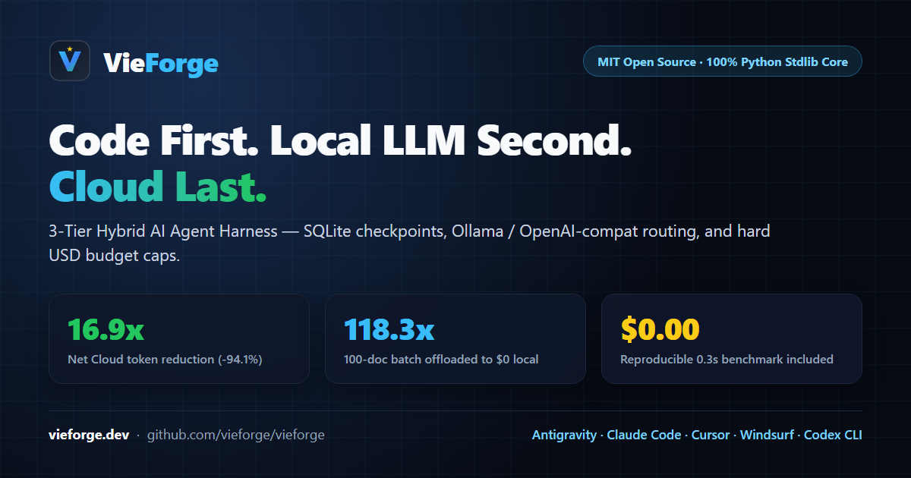
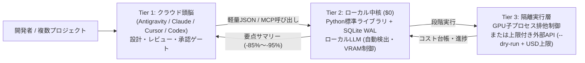

<p align="right">
  <a href="README.md">English</a> | <a href="README.vi.md">Tiếng Việt</a> | <strong>日本語</strong>
</p>

# VieForge（ヴィエフォージ）

**まずコード。次にローカルLLM。クラウドは最後に。**

[](https://github.com/vieforge/vieforge/actions/workflows/ci.yml)
[](https://pypi.org/project/vieforge/)
[](LICENSE)
[](pyproject.toml)
[](docs/ja/SECURITY_AND_COMPLIANCE.md)
[](skills/three-tier-orchestrator/references/hardware-profiles.md)
[](https://vieforge.dev)

<p align="center">
  <a href="https://vieforge.dev">
    
  </a>
</p>

**VieForge** は、お手元のPCや社内ワークステーションを **チェックポイント保存・予算上限ガード・複数プロジェクト並列対応のローカルAI実行基盤** に変えるオープンソース（MIT）ハーネスです。

反復的なバッチ処理、膨大なCIログ解析、途中エラーによる再実行をローカルへ逃がすことで、**Antigravity・Claude Code・Cursor・Codeium/Windsurf・Cline・VS Code Copilot・Codex CLI** のクラウドAI消費量とAPI費用を **実測 70〜90% 削減** します。

---

## 日本語ドキュメント一覧（導入評価・社内稟議向け）

日本の開発チーム・情報システム部門・法人導入ご担当者様向けに、検証手順・セキュリティ仕様・稟議チェックリストを体系的にまとめています。

| ドキュメント | 対象・目的 |
| :--- | :--- |
| **[5分導入・評価ガイド（アンインストール手順付き）](docs/ja/QUICKSTART.md)** | 外部APIキー不要のオフライン体験（`--mock-llm`）、11種LLM設定、IDE連携、完全削除手順 |
| **[セキュリティ・ライセンス・コンプライアンス仕様書](docs/ja/SECURITY_AND_COMPLIANCE.md)** | OS非改変保証、ゼロテレメトリ、シークレット自動秘匿、MITクリーンルーム監査、SLSA/PEP 740証明 |
| **[導入評価チェックリスト・FAQ（稟議書サポート）](docs/ja/EVALUATION_AND_FAQ.md)** | 社内承認にそのまま添付できる10項目検証コマンド、課金暴走対策、オープンコア範囲、お問い合わせ窓口 |

---

## 3層ハイブリッド設計（なぜ確実にコストが下がるのか）



| 階層 | 実行主体 | 主な役割 | 目安コスト |
| :--- | :--- | :--- | :---: |
| **Tier 1（頭脳）** | クラウドAIエージェント | 設計判断、コードレビュー、承認ゲート、根本原因の調査 | クラウド枠 |
| **Tier 2（中核）** | Python標準ライブラリ + SQLite WAL + ローカルLLM | 項目別チェックポイント、SHA-256重複排除、JSON整形、CIログ圧縮、秘匿処理 | **`$0.00`** |
| **Tier 3（実行）** | OS隔離GPUサブプロセス / 予算上限付き外部API | 高負荷ローカル推論・メディア処理、および `--dry-run`・`MAX_JOB_USD`・`DAILY_USD_CAP` 保護下の外部API | **`$0` または上限固定** |

---

## 幅広いLLM・推論モデルへの対応（11プリセット + 自動検出）

特定のモデルやツールに縛られず、お手元の環境に合わせて **1単語の指定** で切り替えられます（`TIERFORGE_LLM_PROVIDER`）。

- **ローカルサーバー自動検出（`provider="auto"`）:** **Ollama**（`:11434`）が起動していない場合でも、**LM Studio**（`:1234`）・**llama.cpp**（`:8080`）・**vLLM**（`:8000`）・**Jan**（`:1337`）を自動で検出して接続します。
- **主要クラウドAPI直接対応:** **Google Gemini**・**Anthropic Claude（Messages API直接対応）**・**OpenAI**・**DeepSeek**・**Groq**・**OpenRouter**。各社の標準環境変数（`GEMINI_API_KEY`, `ANTHROPIC_API_KEY`, `OPENAI_API_KEY` 等）を自動読み込みします。
- **推論モデル（Reasoning）対応:** **DeepSeek-R1・QwQ・Qwen3** が出力する `<think>...</think>` ブロックを自動除去してJSONを抽出。`o1`/`o3`/`gpt-5` 系の `temperature` 制約にも自動対応します。

---

## 誠実な適用範囲（損益分岐点の透明性）

VieForgeは万能薬ではありません。導入前に **「使うべき場面」と「使わなくてよい場面」** を明確に開示しています。

- **初回オーバーヘッド:** セッション開始時に `1,459トークン`（`SKILL.md` + `AGENTS.md` + MCP定義）を1回だけ消費します。
- **導入効果が出る境界:** 冗長なCIログ解析 **1回**、またはバッチ処理 **3〜5件** で元が取れます。
- **使わなくてよい場面（L0）:** 単発のちょっとした質問や、1ファイルの数行修正だけであれば、クラウドAIを直接呼ぶ方がシンプルで効率的です。

### 実測ベンチマーク（お手元のPCで0.3秒で再現可能）

```bash
pip install vieforge
vieforge bench
```

| 実運用ワークロード | クラウド単体 | VieForge併用 | 削減倍率 | 削減率 |
| :--- | ---: | ---: | ---: | ---: |
| セッション初回オーバーヘッド（1回のみ） | 0 | 1,459 | — | 初回負担 |
| 100文書バッチ分類 & JSON抽出 | 23,662 | 200 | **118.3倍** | **-99.2%** |
| 冗長なCI / Pytestログ圧縮（390行） | 11,150 | 998 | **11.2倍** | **-91.0%** |
| 50件バッチの30件目中断 → SQLite再開 | 17,920 | 457 | **39.2倍** | **-97.4%** |
| **純合計（初回1,459トークン込み）** | **52,732** | **3,114** | **16.9倍** | **-94.1%** |

ご自身のプロジェクトでの実測効果は `vieforge savings --html report.html` でいつでも確認できます。

---

## ライセンス・安全性・お問い合わせ

- **コアライセンス:** MIT License（`core/` は **100% Python標準ライブラリのみ**・外部依存ゼロ）
- **供給網の透明性:** PyPI OIDC Trusted Publishing + **PEP 740 / SLSA Build Provenance** 署名付きリリース
- **ライセンス自動監査:** `python -m core.license_audit` により `AGPL-3.0`・`BUSL-1.1`・`CC-BY-NC` を自動ブロック
- **導入相談・法人ライセンス:** `hello@vieforge.dev`
- **セキュリティ報告:** `security@vieforge.dev`（または GitHub Private Security Advisories）
