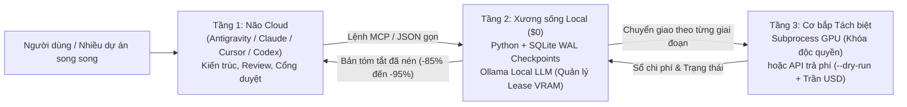

<p align="right">
  <a href="README.md">English</a> | <strong>Tiếng Việt</strong>
</p>

# VieForge

**Code trước — Local LLM thứ hai — Cloud sau cùng.**

[](https://github.com/vieforge/vieforge/actions/workflows/ci.yml)
[](LICENSE)
[](pyproject.toml)
[](LEGAL_AND_COMPLIANCE.md)
[](README.vi.md)
[](https://vieforge.dev)

Biến mọi máy tính cá nhân thành một **worker AI cục bộ có checkpoint, khóa ngân sách và hỗ trợ đa dự án**, giúp giảm **70–90%** lượng token Cloud Agent và chi phí API. Xây dựng theo chuẩn mở **MCP (Model Context Protocol)** + **Agent Skill (`SKILL.md` / `AGENTS.md`)** cho **Antigravity, Claude Code, Cursor, Windsurf và Codex CLI**.

---

## Cài đặt cho người mới (Chỉ cần nhắn 1 câu cho AI Agent)

Bạn không cần biết Git, Python hay MCP. Mở **Antigravity, Claude Code, Cursor, Windsurf hoặc Codex CLI** và dán đúng 1 câu sau:

> *"Hãy tải repo `https://github.com/vieforge/vieforge`, đọc file `AGENT_INSTALL.md`, chạy `python scripts/quick_setup.py`, rồi giải thích kết quả và bảng tiết kiệm (Savings Receipt) bằng tiếng Việt dễ hiểu giúp tôi."*

AI Agent sẽ tự kiểm tra phần cứng máy bạn, cài Skill cho IDE, sinh sẵn file cấu hình MCP đúng đường dẫn tuyệt đối và chạy thử demo `$0`.

---

## Kiến trúc Lai 3 Tầng



| Tầng | Thành phần thực thi | Trách nhiệm chính | Chi phí mục tiêu |
| :--- | :--- | :--- | :---: |
| **Tầng 1 (Não)** | Cloud Agent (Antigravity / Claude / Cursor / Windsurf / Codex) | Thiết kế kiến trúc, schema, sửa code, cổng duyệt (Approval Gates), gỡ lỗi gốc | Quota Cloud |
| **Tầng 2 (Xương sống)** | Python thuần + SQLite WAL + Local LLM (Ollama / OpenAI-compat) | Lưu checkpoint từng item, chống chạy trùng SHA-256, xử lý hàng loạt & nén log | **`$0.00`** |
| **Tầng 3 (Cơ bắp)** | Subprocess GPU tách biệt / API trả phí có trần | Tác vụ GPU nặng hoặc API trả phí bị khóa bởi `--dry-run`, `MAX_RETRY <= 2`, `MAX_JOB_USD`, `DAILY_USD_CAP` | **`$0` hoặc Có trần** |

---

## Chạy thử trong 5 phút (`$0`, không cần cài thư viện ngoài)

```bash
git clone https://github.com/vieforge/vieforge.git
cd vieforge

# 1 lệnh tự động kiểm tra môi trường + cài Skill + sinh MCP config + chạy demo:
python scripts/quick_setup.py

# Hoặc tự chạy đủ 3 pha Demo 01 (chạy được ngay cả khi chưa cài Ollama nhờ --mock-llm):
python examples/01_batch_doc_processor/run_demo.py --dry-run
python examples/01_batch_doc_processor/run_demo.py --reset --mock-llm --simulate-interrupt-after 2
python examples/01_batch_doc_processor/run_demo.py --mock-llm
```

---

## Bảng Đo Token Thực Tế (Tự kiểm chứng trong 0.3 giây, `$0`)

Chạy trực tiếp trên máy bạn để kiểm chứng chính xác lượng token Cloud tiêu thụ (`ceil(chars / 4)`):

```bash
python scripts/benchmark_token_savings.py
```

| Khối lượng công việc thực tế | Không dùng VieForge | Dùng VieForge (Cloud) | Giảm số lần | Tiết kiệm |
| :--- | ---: | ---: | ---: | ---: |
| Chi phí nền 1 lần mỗi phiên (`SKILL.md` 691 + `AGENTS.md` 448 + MCP 320) | 0 | 1,459 | — | Tính 1 lần |
| Phân loại & trích xuất JSON cho lô 100 tài liệu thực tế | 23,662 | 200 | **118.3x** | **-99.2%** |
| Nén log CI / Pytest + Traceback lỗi dài 390 dòng | 11,150 | 998 | **11.2x** | **-91.0%** |
| Job 50 item bị sập ở item 30/50 + chạy tiếp bằng Checkpoint SQLite | 17,920 | 457 | **39.2x** | **-97.4%** |
| **TỔNG THỰC CHI (đã cộng 1,459 token nền)** | **52,732** | **3,114** | **16.9x** | **-94.1%** |

> **Minh bạch điểm hòa vốn:** VieForge hoàn vốn 1,459 token nền chỉ sau **1 lần nén log lỗi** hoặc **3–5 mục xử lý lô**. Với câu hỏi chat ngắn 1–2 lượt, không cần bật VieForge.

---

## An toàn Đa nhiệm Đa dự án (Chạy 3+ dự án song song)

Khi mở đồng thời nhiều dự án trên Antigravity / Claude Code trên cùng một máy tính, `core/concurrency.py` bảo vệ tài nguyên bằng khóa file cấp OS (`msvcrt` / `fcntl`, 100% Python stdlib):
- **Quản lý Lease VRAM Ollama (`OllamaLeaseManager`):** Giữ model nóng suốt batch và chỉ xả VRAM (`keep_alive=0`) khi **dự án cuối cùng** kết thúc (tự dọn PID đã tắt).
- **Xếp hàng GPU Tầng 3 (`exclusive_gpu_lock`):** Tránh 2–3 dự án cùng tràn vào card 8 GB VRAM gây OOM.
- **Ghi sổ chi phí nguyên tử (`daily_spend.json`):** Khóa liên tiến trình + `os.replace`, không bao giờ mất dữ liệu chi tiêu.

---

## Kiểm chứng Đa nền tảng 3 OS & Hỗ trợ Local LLM Mở rộng

Mọi bản phát hành được kiểm định tự động trên **Ubuntu Linux, macOS và Windows** qua [Cổng Chất lượng Đối chiếu Chéo 2 Trục](docs/CROSS_OS_QUALITY_GATE.md) (cài wheel sạch ngoài repo, test khóa đa tiến trình thật `fcntl`/`msvcrt`, đo tốc độ `StateDB` & `output_trimmer`, và so sánh chéo kết quả 3 OS):

```bash
uv run --extra dev pytest -v
uv run python scripts/audit_step.py --step verify
uv run python scripts/verify_cross_os.py run --step local_check --out data/os_report_local.json
```

- **Tương thích Local LLM linh hoạt:** Hỗ trợ **Ollama** nguyên bản (`:11434` + tự xả VRAM `keep_alive=0`) và tự nhận diện máy chủ chuẩn **OpenAI-compatible** (**LM Studio** `:1234/v1`, **llama.cpp** `:8080/v1`, **vLLM** `:8000/v1`) qua `TIERFORGE_LLM_BASE_URL` / `TIERFORGE_LLM_API_STYLE=auto`.
- **Tách namespace checkpoint (`scoped_job_id`):** Các dự án dùng chung SQLite WAL không bao giờ đụng `job_id`.

---

## Cam kết Pháp lý, Bảo mật & Không can thiệp Hệ điều hành
- **100% MIT & Python Stdlib (`core/`):** Được kiểm tra tự động bởi `python -m core.license_audit`, chặn tuyệt đối `BUSL-1.1`, `AGPL-3.0`, `CC-BY-NC`.
- **Zero OS-Mutation:** Không bao giờ sửa Registry Windows, dịch vụ hệ thống, mạng/IPv6 hay pagefile.
- **Tài liệu chi tiết:** Xem [README.md](README.md) (bản tiếng Anh đầy đủ), [LEGAL_AND_COMPLIANCE.md](LEGAL_AND_COMPLIANCE.md), và [SECURITY.md](SECURITY.md).
- **Website & Liên hệ:** [https://vieforge.dev](https://vieforge.dev) | `hello@vieforge.dev` | Bảo mật: `security@vieforge.dev`
- **Ủng hộ dự án:** VieForge hoàn toàn miễn phí vĩnh viễn theo giấy phép **MIT**. Nếu công cụ giúp bạn tiết kiệm đáng kể chi phí Cloud API, bạn có thể [mời tác giả một ly cà phê trên Ko-fi](https://ko-fi.com/aivieforge) để tiếp sức duy trì máy trạm test local.
- **Lưu ý Thương hiệu (Trademark):** Mã nguồn được phát hành theo giấy phép **MIT**, nhưng tên thương hiệu và nhận diện **VieForge** thuộc quyền sở hữu của **VieForge Contributors** (các bản fork cần sử dụng tên khác).
